# 🛒 Mercado Express — Spring Security MVC + PostgreSQL

Aplicação **Spring Boot + Spring MVC + Thymeleaf + Spring Security** para um mercado *express* (frutas, produtos de limpeza, higiene, meias...), com persistência em **PostgreSQL**, **tela de login própria**, **tela de cadastro (Sign Up)**, **dois tipos de usuário** (ADMIN e CLIENTE) e **deploy no Render**.

Projeto do **Checkpoint 5 – Parte 1 (Spring Security MVC, Deploy e PostgreSQL)** da disciplina **Java Advanced** — Tecnologia em Análise e Desenvolvimento de Sistemas (TDS) — FIAP.

> *"Quem ouve, esquece. Quem vê, lembra. Quem faz, aprende."*

🔗 **Deploy (produção):** https://mercado-express-mvc-1u1j.onrender.com
🛠️ **Plataforma de deploy:** Render (Web Service Docker + Render PostgreSQL)
💻 **IDE utilizada:** IntelliJ IDEA

---

## 📑 Sumário

1. [Sobre o projeto](#-sobre-o-projeto)
2. [Spring Initializr e dependências](#-spring-initializr-e-dependências)
3. [Tecnologias](#-tecnologias)
4. [Arquitetura e estrutura](#️-arquitetura-e-estrutura)
5. [Banco de dados PostgreSQL](#️-banco-de-dados-postgresql)
6. [Segurança: login, Sign Up e perfis](#-segurança-login-sign-up-e-perfis)
7. [Telas e CRUD (com prints)](#️-telas-e-crud)
8. [Configuração (application.yml)](#️-configuração-applicationyml)
9. [Como executar localmente](#️-como-executar-localmente)
10. [Deploy no Render](#-deploy-no-render)
11. [Autores](#-autores)

---

## 📌 Sobre o projeto

O Mercado Express é um sistema web em que:

- a **landing page pública** é a `index.html` (rota `/`);
- o visitante pode **criar uma conta** (Sign Up), que é salva na tabela **`TDS_Users_Mercado`**;
- se alguém tentar entrar com um usuário que **não existe**, é **redirecionado automaticamente para a tela de Sign Up**;
- após o login, cada perfil vai para a **sua tela de acesso restrito**:
  - **ADMIN** → `/admin` (painel de gestão + CRUD completo de produtos + gestão de usuários);
  - **CLIENTE** → `/cliente` (área do cliente com catálogo e consulta de produtos);
- os produtos ficam na tabela **`TDS_Sec_MVC_TB_Mercado`** e todas as operações **Create, Read, Update e Delete** aparecem na interface como **botões e links**.

---

## 🧩 Spring Initializr e dependências

O projeto foi criado no [Spring Initializr](https://start.spring.io) com a configuração abaixo.

👉 **Link com tudo já preenchido:**
[start.spring.io (Mercado Express – Parte 1)](https://start.spring.io/#!type=maven-project&language=java&platformVersion=4.1.1&packaging=jar&configurationFileFormat=yaml&jvmVersion=21&groupId=br.com.fiap&artifactId=mercadoexpress&name=mercadoexpress&description=Mercado%20Express%20-%20CP5%20Parte%201&packageName=br.com.fiap.mercadoexpress&dependencies=web,thymeleaf,security,data-jpa,postgresql,validation,lombok,devtools)

| Campo | Valor |
|---|---|
| Project | **Maven** |
| Language | **Java** |
| Spring Boot | **4.1.1** |
| Group | `br.com.fiap` |
| Artifact / Name | `mercadoexpress` |
| Package name | `br.com.fiap.mercadoexpress` |
| Packaging | **Jar** |
| Configuration | **YAML** |
| Java | **21** |

| Dependência | Para que serve |
|---|---|
| **Spring Web** | Spring MVC, controllers e servidor Tomcat embutido |
| **Thymeleaf** | Templates HTML renderizados no servidor |
| **Spring Security** | Autenticação, autorização por perfil, CSRF |
| **Spring Data JPA** | Repositórios e persistência com Hibernate |
| **PostgreSQL Driver** | Conexão JDBC com o PostgreSQL |
| **Validation** | Validação dos formulários (`@NotBlank`, `@Email`...) |
| **Lombok** | Getters/setters/construtores gerados (`@Getter`, `@Setter`, `@Data`, `@RequiredArgsConstructor`) |
| **Spring Boot DevTools** | Reload automático em desenvolvimento |

> Além dessas, foi adicionada manualmente no `pom.xml` a `thymeleaf-extras-springsecurity6`, que habilita o atributo `sec:authorize` nas telas (mostrar/esconder botões conforme o perfil).

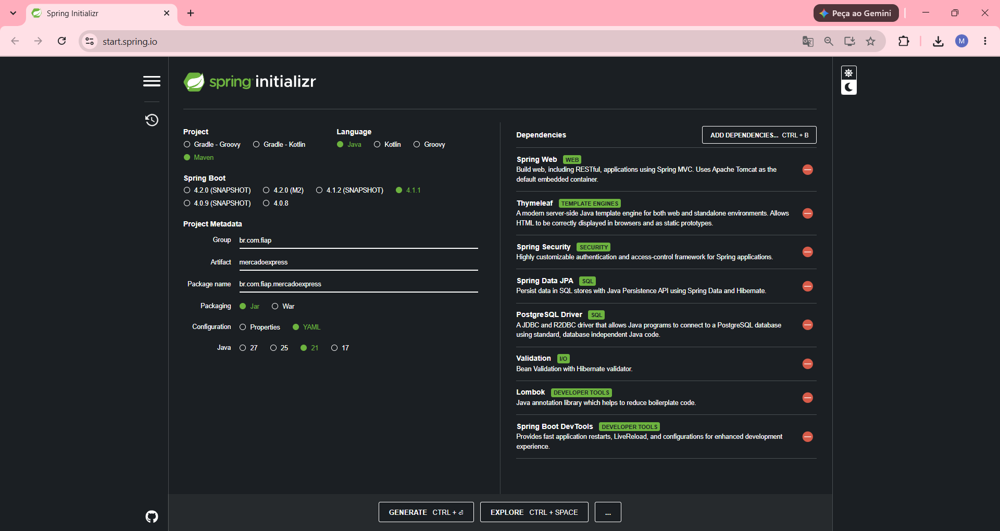

---

## 🧰 Tecnologias

| Tecnologia | Finalidade |
|---|---|
| Java 21 | Linguagem |
| Spring Boot 4.1 | Framework principal |
| Spring MVC + Thymeleaf | Interface web e rotas |
| Spring Security 7 | Login customizado, Sign Up, perfis ADMIN/CLIENTE, BCrypt, CSRF |
| Spring Data JPA / Hibernate | Persistência |
| PostgreSQL 16 | Banco de dados |
| Lombok | Menos código repetitivo |
| Maven | Build e dependências |
| Docker | Imagem usada no deploy |
| Render | Hospedagem da aplicação e do PostgreSQL |

---

## 🏗️ Arquitetura e estrutura

```
Navegador ──HTTP──► Spring Security (filtros) ──► Controller ──► Service ──► Repository ──► PostgreSQL
                         │                            │
                  login / perfis / CSRF          Thymeleaf (HTML)
```

```
mercado-express-mvc/
├── src/main/java/br/com/fiap/mercadoexpress/
│   ├── config/
│   │   ├── SecurityConfig.java         # Regras de acesso, login customizado, logout, BCrypt
│   │   ├── LoginSuccessHandler.java    # ADMIN -> /admin | CLIENTE -> /cliente
│   │   ├── LoginFailureHandler.java    # Usuário inexistente -> /cadastro (Sign Up)
│   │   └── DataInitializer.java        # Cria o ADMIN, um CLIENTE demo e produtos iniciais
│   ├── controllers/
│   │   ├── HomeController.java         # / (index.html) e /acesso-negado
│   │   ├── AuthController.java         # /login e /cadastro (Sign Up)
│   │   ├── ProdutoWebController.java   # CRUD de produtos
│   │   ├── AdminController.java        # /admin e /admin/usuarios
│   │   └── ClienteController.java      # /cliente
│   ├── dtos/CadastroUsuarioDTO.java    # Dados do formulário de Sign Up
│   ├── models/
│   │   ├── Produto.java                # @Entity -> TDS_Sec_MVC_TB_Mercado
│   │   ├── Usuario.java                # @Entity -> TDS_Users_Mercado
│   │   └── Role.java                   # ADMIN | CLIENTE
│   ├── repositories/                   # ProdutoRepository, UsuarioRepository
│   └── services/                       # ProdutoService, UsuarioService, UsuarioDetailsService
├── src/main/resources/
│   ├── application.yml                 # Configuração do PostgreSQL
│   ├── static/css/style.css
│   └── templates/
│       ├── index.html                  # Landing page
│       ├── login.html                  # Login customizado
│       ├── cadastro.html               # Sign Up
│       ├── acesso-negado.html
│       ├── fragments.html              # Navbar, alertas e rodapé reutilizáveis
│       ├── produtos/ (lista, detalhe, form)
│       ├── admin/ (painel, usuarios)
│       └── cliente/ (area)
├── docs/schema-referencia.sql          # DDL de referência das tabelas
├── docker-compose.yml                  # PostgreSQL local
├── Dockerfile                          # Imagem para o deploy
├── render.yaml                         # Blueprint do Render (app + banco)
└── pom.xml
```

---

## 🗄️ Banco de dados PostgreSQL

As tabelas são criadas automaticamente pelo Hibernate (`ddl-auto: update`). O PostgreSQL grava os nomes em minúsculas (`tds_sec_mvc_tb_mercado`, `tds_users_mercado`). O DDL de referência está em [`docs/schema-referencia.sql`](docs/schema-referencia.sql).

### `TDS_Sec_MVC_TB_Mercado` (produtos)

| Coluna | Tipo | Descrição |
|---|---|---|
| `id` | BIGSERIAL (PK) | Identificador gerado automaticamente |
| `nome` | VARCHAR(100) | Nome do produto |
| `tipo` | VARCHAR(60) | Tipo/categoria (Fruta, Limpeza, Higiene, Vestuário...) |
| `setor` | VARCHAR(60) | Setor do mercado |
| `tamanho` | VARCHAR(40) | Tamanho/porção |
| `preco` | NUMERIC(10,2) | Preço de venda |
| `preco_custo` | NUMERIC(10,2) | Preço de custo (visível só para o ADMIN) |
| `estoque` | INTEGER | Quantidade em estoque |

### `TDS_Users_Mercado` (perfis do Sign Up)

| Coluna | Tipo | Descrição |
|---|---|---|
| `id` | BIGSERIAL (PK) | Identificador |
| `nome` | VARCHAR(100) | Nome completo |
| `email` | VARCHAR(120) UNIQUE | E-mail |
| `username` | VARCHAR(40) UNIQUE | Login |
| `senha` | VARCHAR(100) | **Hash BCrypt** (a senha nunca é salva em texto puro) |
| `role` | VARCHAR(20) | `ADMIN` ou `CLIENTE` |
| `data_cadastro` | TIMESTAMP | Data do cadastro |

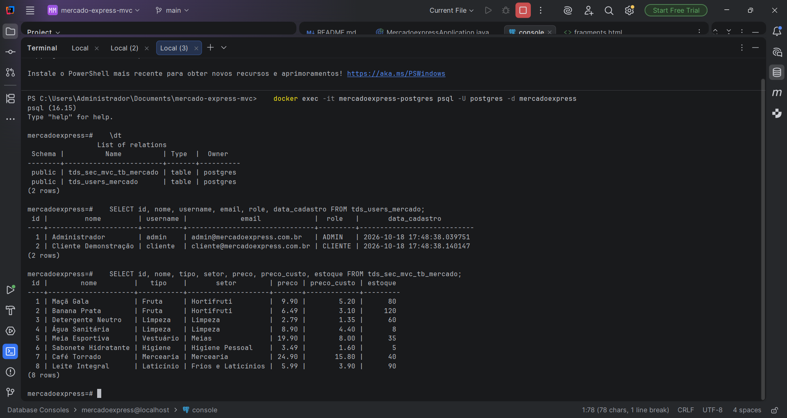

---

## 🔐 Segurança: login, Sign Up e perfis

### Rotas e permissões

| Rota | Método | Acesso |
|---|---|---|
| `/` (index.html), `/login`, `/cadastro`, `/acesso-negado`, `/css/**` | GET/POST | 🔓 Público |
| `/admin`, `/admin/usuarios`, `/admin/usuarios/{id}/perfil` | GET/POST | 🔒 **ADMIN** |
| `/produtos/novo`, `/produtos/{id}/editar` | GET | 🔒 **ADMIN** |
| `/produtos` (salvar), `/produtos/{id}/excluir` | POST | 🔒 **ADMIN** |
| `/cliente` | GET | 🔒 **CLIENTE** |
| `/produtos`, `/produtos/{id}` (listar / consultar) | GET | 🔒 **ADMIN e CLIENTE** |

Um usuário logado que tenta abrir uma rota que não é do seu perfil vê a tela **Acesso negado** (`/acesso-negado`).

### Implementação da tela de login customizada

A tela padrão do Spring Security foi substituída pela `login.html` própria:

```java
.formLogin(form -> form
        .loginPage("/login")                 // nossa tela (templates/login.html)
        .loginProcessingUrl("/login")        // POST tratado pelo Spring Security
        .successHandler(loginSuccessHandler) // redireciona conforme o perfil
        .failureHandler(loginFailureHandler) // usuário sem conta -> Sign Up
        .permitAll())
```

O formulário envia `username` e `password` via `POST /login`. Como o form usa `th:action`, o Thymeleaf insere automaticamente o **token CSRF** (o CSRF fica habilitado).

### Fluxo de autenticação

```
             ┌──────────────┐  usuário existe e senha ok   ┌───────────────────────────┐
  /login ───►│ Spring       │─────────────────────────────►│ LoginSuccessHandler       │
  (POST)     │ Security     │                              │ ADMIN  -> /admin          │
             │ + BCrypt     │                              │ CLIENTE -> /cliente       │
             └──────┬───────┘                              └───────────────────────────┘
                    │ falhou
                    ▼
          ┌───────────────────────┐   usuário NÃO existe   ┌─────────────────────────────┐
          │ LoginFailureHandler   │───────────────────────►│ /cadastro?semConta (Sign Up)│
          └──────────┬────────────┘                        └─────────────────────────────┘
                     │ senha errada
                     ▼
               /login?error
```

**LoginFailureHandler** (redireciona quem não tem login para o Sign Up):

```java
if (username != null && !username.isBlank()
        && !usuarioRepository.existsByUsernameIgnoreCase(username.trim())) {
    response.sendRedirect("/cadastro?semConta&username=" + username);
    return;
}
response.sendRedirect("/login?error");
```

**UsuarioDetailsService** (lê o usuário da tabela `TDS_Users_Mercado`):

```java
Usuario usuario = repository.findByUsernameIgnoreCase(username)
        .orElseThrow(() -> new UsernameNotFoundException("Usuário não encontrado"));
return User.withUsername(usuario.getUsername())
        .password(usuario.getSenha())        // hash BCrypt
        .roles(usuario.getRole().name())     // ROLE_ADMIN ou ROLE_CLIENTE
        .build();
```

### Sign Up

`POST /cadastro` valida os campos (nome, e-mail, usuário, senha e confirmação), verifica se usuário/e-mail já existem, criptografa a senha com **BCrypt** e salva o perfil em `TDS_Users_Mercado` com o papel **CLIENTE**. Depois, redireciona para o login com mensagem de sucesso.

### Dois tipos de usuário

| Perfil | Como é criado | O que pode fazer |
|---|---|---|
| **ADMIN** | Criado na inicialização (`ADMIN_USERNAME` / `ADMIN_PASSWORD`) ou promovido por outro ADMIN | Painel com indicadores, CRUD completo de produtos, ver custo/margem, gerenciar usuários |
| **CLIENTE** | Tela de Sign Up | Área do cliente, catálogo com busca e consulta de cada produto |

**Usuários de demonstração:**

| Perfil | Usuário | Senha |
|---|---|---|
| ADMIN | `admin` | `admin123` (em produção, definida pela variável `ADMIN_PASSWORD`) |
| CLIENTE | `cliente` | `cliente123` |

Na tela, os botões aparecem conforme o perfil com o `sec:authorize` do Thymeleaf:

```html
<a sec:authorize="hasRole('ADMIN')" th:href="@{/produtos/novo}" class="btn btn-primary">+ Novo produto</a>
```

---

## 🖥️ Telas e CRUD

> 📸 Os prints ficam na pasta [`docs/img`](docs/img).

### Landing page — `GET /` (index.html)
Página pública de apresentação, com os botões **Criar minha conta** e **Entrar**.

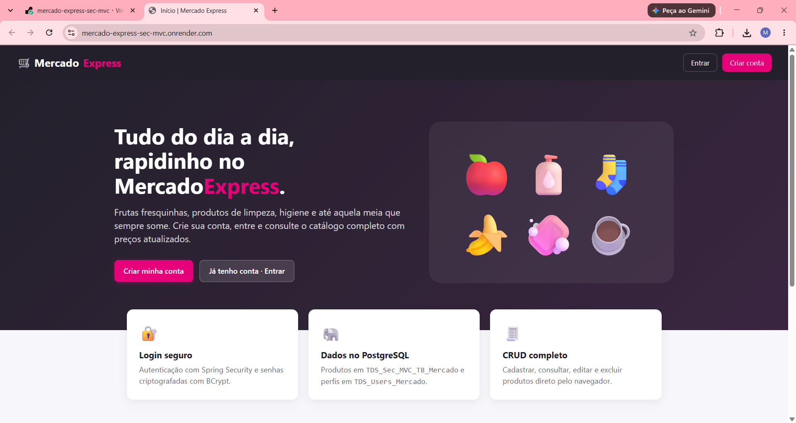

### Login customizado — `GET /login`
Tela própria (não é a padrão do Spring Security). Mostra mensagens de erro, de logout e de cadastro concluído.


### Usuário sem conta → Sign Up — `GET /cadastro?semConta`
Ao tentar entrar com um usuário que não existe, o sistema leva para o cadastro já com o usuário preenchido.

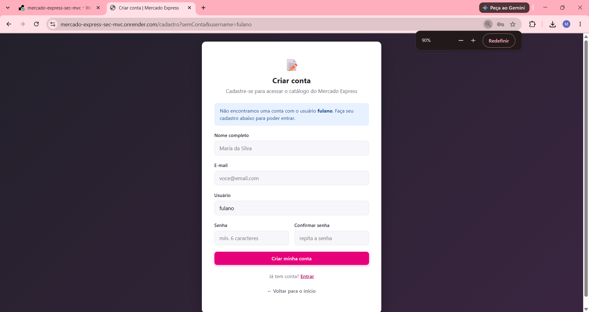

### Sign Up — `GET/POST /cadastro`
Formulário com validação. O perfil é salvo em `TDS_Users_Mercado`.

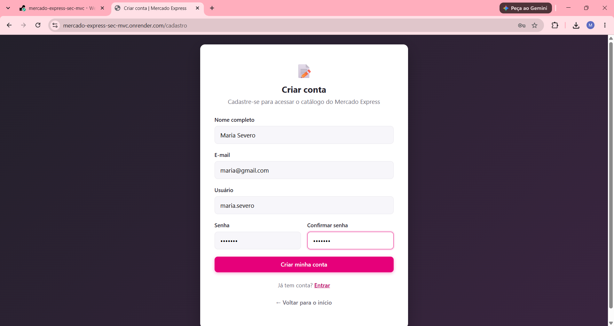

### Área restrita do ADMIN — `GET /admin`
Destino do ADMIN após o login: indicadores (produtos, usuários, valor do estoque, lucro potencial), alerta de estoque baixo e atalhos do CRUD.

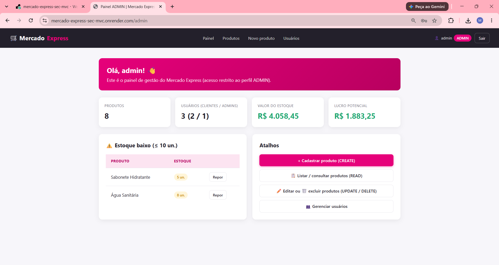

### Área restrita do CLIENTE — `GET /cliente`
Destino do CLIENTE após o login: boas-vindas com os dados do perfil e catálogo com busca.

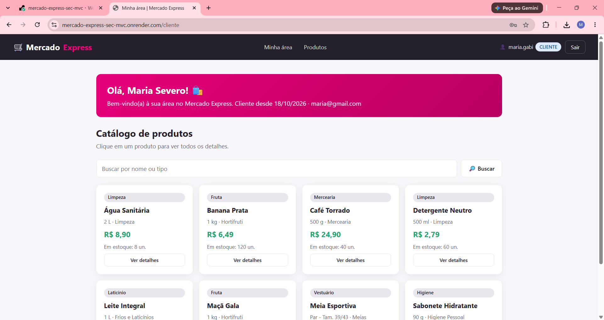

### READ — Listagem e busca — `GET /produtos?busca=`
Consulta a tabela `TDS_Sec_MVC_TB_Mercado`. O ADMIN vê os botões **Editar** e **Excluir**; o CLIENTE só consulta.

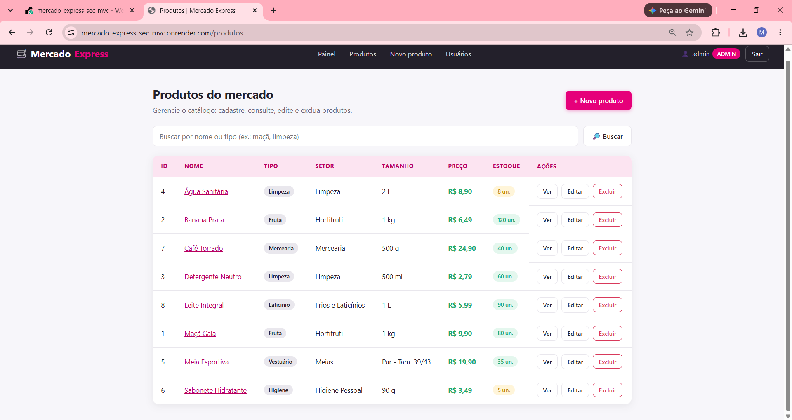

### READ — Consulta de um produto — `GET /produtos/{id}`
Retorna as informações do produto solicitado (o ADMIN também vê custo e margem).

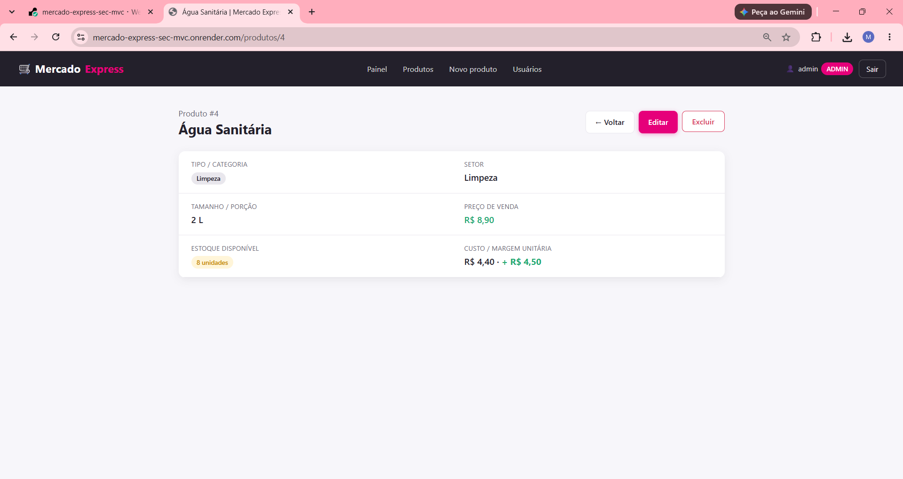

### CREATE — `GET /produtos/novo` + `POST /produtos`
Formulário com validação; ao salvar, o `ProdutoService` faz o commit no PostgreSQL.


### UPDATE — `GET /produtos/{id}/editar` + `POST /produtos`
O mesmo formulário é reaproveitado; o campo `id` oculto indica que é uma atualização.

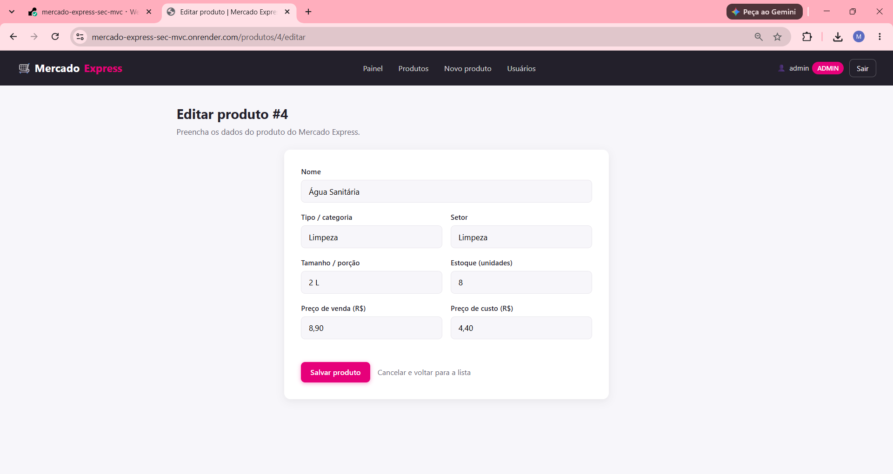

### DELETE — `POST /produtos/{id}/excluir`
Botão com confirmação antes de remover o registro.

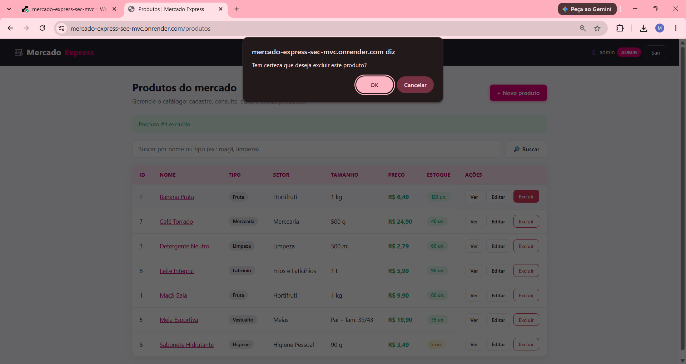

### Gestão de usuários (ADMIN) — `GET /admin/usuarios`
Lista os perfis da tabela `TDS_Users_Mercado` e permite promover um CLIENTE a ADMIN (ou o inverso).

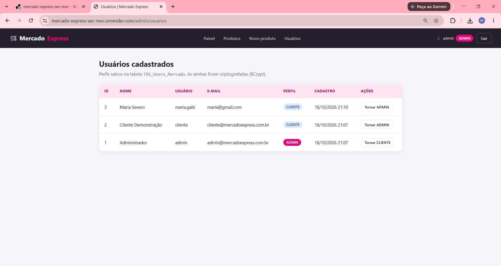

### Acesso negado — `/acesso-negado`
Exibida quando um CLIENTE tenta acessar uma rota de ADMIN (ex.: `/produtos/novo`).

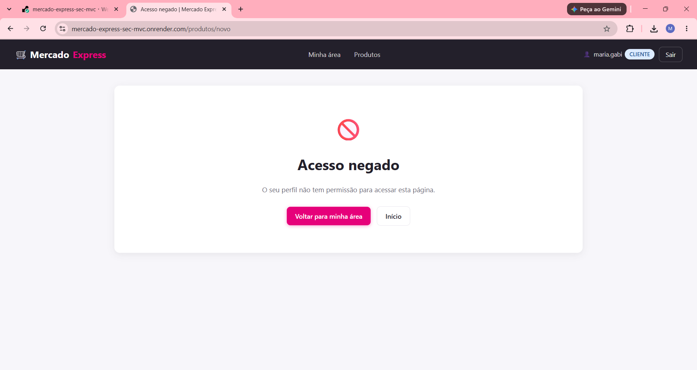

---

## ⚙️ Configuração (application.yml)

```yaml
server:
  port: ${PORT:8080}

spring:
  datasource:
    url: ${DB_URL:jdbc:postgresql://${DB_HOST:localhost}:${DB_PORT:5432}/${DB_NAME:mercadoexpress}}
    username: ${DB_USER:postgres}
    password: ${DB_PASSWORD:postgres}
    driver-class-name: org.postgresql.Driver
  jpa:
    hibernate:
      ddl-auto: update
    show-sql: true

app:
  admin:
    username: ${ADMIN_USERNAME:admin}
    password: ${ADMIN_PASSWORD:admin123}
```

| Variável | Padrão (local) | Descrição |
|---|---|---|
| `DB_HOST` / `DB_PORT` / `DB_NAME` | `localhost` / `5432` / `mercadoexpress` | Servidor PostgreSQL |
| `DB_USER` / `DB_PASSWORD` | `postgres` / `postgres` | Credenciais |
| `DB_URL` | — | (opcional) URL JDBC completa, ex.: Neon/Supabase |
| `ADMIN_USERNAME` / `ADMIN_PASSWORD` | `admin` / `admin123` | ADMIN criado na 1ª execução |
| `SEED_DEMO_DATA` | `true` | Cria o cliente demo e produtos iniciais |
| `PORT` | `8080` | Porta HTTP (o Render define automaticamente) |

---

## ▶️ Como executar localmente

**Pré-requisitos:** Java 21, Docker (para o PostgreSQL) e IntelliJ IDEA (ou Maven Wrapper).

```bash
git clone <link-deste-repositorio>
cd mercado-express-mvc

# 1. Sobe o PostgreSQL local (banco mercadoexpress, usuário/senha postgres)
docker compose up -d

# 2. Roda a aplicação
./mvnw spring-boot:run          # Windows: mvnw.cmd spring-boot:run
```

Acesse **http://localhost:8080** e entre com `admin / admin123` ou `cliente / cliente123` — ou crie uma conta nova.

> Sem Docker? Instale o PostgreSQL, crie o banco `mercadoexpress` e ajuste `DB_USER`/`DB_PASSWORD` na *Run Configuration* do IntelliJ.

---

## 🌐 Deploy no Render

**Plataforma:** Render — Web Service (Docker) + Render PostgreSQL.

**Opção A — Blueprint (automático):**
1. No Render: **New → Blueprint** e selecione este repositório.
2. O arquivo [`render.yaml`](render.yaml) cria o banco `mercadoexpress-db` e o serviço `mercado-express-sec-mvc` já com `DB_HOST`, `DB_PORT`, `DB_NAME`, `DB_USER` e `DB_PASSWORD` ligados ao banco.
3. Informe o valor de `ADMIN_PASSWORD` quando solicitado e clique em **Apply**.

**Opção B — Manual:**
1. **New → PostgreSQL** (plano Free) e copie *Hostname*, *Port*, *Database*, *Username* e *Password*.
2. **New → Web Service** → conecte o repositório → *Runtime*: **Docker**.
3. Em **Environment**, cadastre `DB_HOST`, `DB_PORT`, `DB_NAME`, `DB_USER`, `DB_PASSWORD` e `ADMIN_PASSWORD`.
4. **Deploy**. O Render define a variável `PORT`, que a aplicação já lê.

🔗 **URL de produção:** https://mercado-express-mvc-1u1j.onrender.com

> No plano gratuito o serviço "dorme" após um tempo sem acesso; o primeiro carregamento pode levar ~1 minuto.

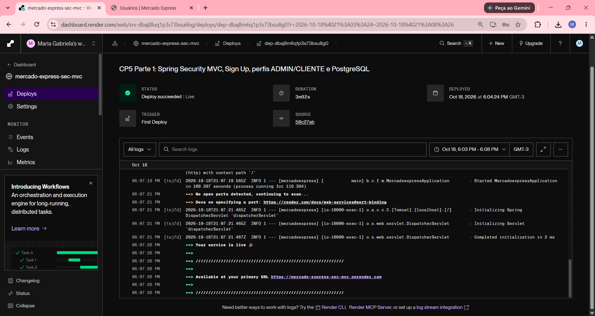

---

## 👤 Autores

| Nome | RM |
|---|---|
| Maria Gabriela Landim Severo | 565146 |
| Samara Porto Souza | 559072 |

**Turma:** 2TDS · **IDE utilizada:** IntelliJ IDEA

---

## 📄 Licença

Projeto acadêmico desenvolvido para fins educacionais na disciplina de Java Advanced — FIAP.
